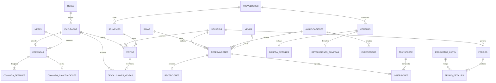

# Mundo a la Carta – Documentación de la Base de Datos

Este directorio contiene la arquitectura, el modelo relacional, los scripts DDL y DML, así como el archivo de base de datos activa para el sistema **Mundo a la Carta**.

---

## 1. Contenido del Directorio

| Archivo | Descripción |
|---|---|
| `mundo_a_la_carta.db` | Base de datos SQLite compilada y sembrada, lista para producción o pruebas locales. |
| `schema.sql` | Definición de tablas, llaves primarias, foráneas, restricciones (`CHECK`, `UNIQUE`) e índices (ANSI SQL / SQLite). |
| `seed.sql` | Inserción de catálogos y datos iniciales (usuarios, empleados, roles, vehículos, souvenirs, compras, reservaciones). |
| `init-db.js` | Script en Node.js que construye la base de datos SQLite usando el motor nativo de Node 22+ (`node:sqlite`). |
| `schema_mysql.sql` | Script DDL optimizado para **MySQL 8.0+** o **MariaDB** (InnoDB, ENUM, ON UPDATE CURRENT_TIMESTAMP). |
| `schema_postgresql.sql` | Script DDL optimizado para **PostgreSQL 14+** (SERIAL, NUMERIC, TIMESTAMP WITH TIME ZONE). |

---

## 2. Diagrama Entidad-Relación (ERD)



---

## 3. Diccionario de Datos

### 3.1 `roles`
Catálogo de niveles de acceso del personal.
- `id` (VARCHAR(30), PK): 'Administrador', 'Gerente', 'Mesero', 'Empleado'.
- `descripcion` (VARCHAR(200)): Descripción del rol.
- `nivel_acceso` (INT): Nivel jerárquico.

### 3.2 `empleados`
Personal con credenciales de acceso.
- `folio` (VARCHAR(10), PK): Clave única de empleado (ej. `000123`).
- `nombre` (VARCHAR(150)): Nombre completo.
- `telefono` (VARCHAR(15)): Número de contacto.
- `area` (VARCHAR(50)): Área departamental.
- `correo` (VARCHAR(100), UNIQUE): Correo corporativo (**RN_30**).
- `rol_puesto` (VARCHAR(30), FK): Enlace a `roles.id` (**RN_29**).
- `clave_contrato` (VARCHAR(20), UNIQUE): Clave del contrato laboral (**RN_30**).
- `usuario` (VARCHAR(50), UNIQUE): Nombre de usuario único para login.
- `password_hash` (VARCHAR(255)): Hash de contraseña (o texto plano en prototipo).
- `estado` (VARCHAR(20)): 'Activo', 'Baja', 'Inactivo' (**RN_22**, **RN_26**).
- `retencion_hasta` (DATE): Retención legal obligatoria de 5 años tras la baja (**RN_28**).

### 3.3 `usuarios` (Clientes)
Clientes registrados en la plataforma.
- `folio` (VARCHAR(10), PK): Folio de cliente (ej. `000123`).
- `nombre` (VARCHAR(150)): Nombre completo.
- `direccion` (VARCHAR(150)): Domicilio.
- `tipo_cliente` (VARCHAR(50)): 'Nuevo', 'Frecuente', 'VIP', 'Corporativo'.
- `contacto_emergencia` (VARCHAR(150)): Nombre de contacto para emergencias.
- `telefono` (VARCHAR(15)): Teléfono titular.
- `telefono_contacto_emergencia` (VARCHAR(15)): Teléfono de emergencia.
- `correo_electronico` (VARCHAR(150), UNIQUE): Correo electrónico del cliente.
- `observaciones_especiales` (VARCHAR(250)): Notas (alergias, requerimientos de movilidad).
- `password_hash` (VARCHAR(255)): Credencial de acceso.
- `estado` (VARCHAR(20)): 'Activo', 'Inactivo', 'Baja'.

### 3.4 `proveedores`
Proveedores de insumos y recuerdos.
- `id` (VARCHAR(20), PK): Clave del proveedor (ej. `10001`).
- `nombre` (VARCHAR(100)): Razón social.
- `departamento` (VARCHAR(50)): Giro o departamento.
- `contacto` (VARCHAR(100)): Persona de contacto.
- `telefono` (VARCHAR(20)): Teléfono de atención.
- `correo` (VARCHAR(100)): Correo de contacto.
- `activo` (BOOLEAN): Estado operativo.

### 3.5 `souvenirs`
Catálogo de recuerdos e inventario comercial.
- `folio` (VARCHAR(10), PK): Folio del souvenir (ej. `000123`).
- `nombre` (VARCHAR(150)): Nombre comercial.
- `precio_unitario` (DECIMAL(10,2)): Precio al público.
- `departamento` (VARCHAR(50)): Cocina, Artesanías, Ropa, Papelería, Accesorios.
- `proveedor_id` (VARCHAR(20), FK): Enlace a `proveedores.id`.
- `descripcion` (VARCHAR(300)): Descripción del artículo.
- `existencia` (INT): Cantidad disponible en almacén.
- `estado` (VARCHAR(20)): 'Activo', 'Inactivo', 'Vigente', 'Descontinuado'.

### 3.6 `transporte`
Flotilla de transporte para experiencias inmersivas móviles.
- `folio` (VARCHAR(10), PK): Folio de unidad (ej. `000123`).
- `vin` (VARCHAR(17), UNIQUE): Número de serie vehicular de 17 caracteres (**RN_189**).
- `equipamiento_inmersivo` (VARCHAR(150)): Tecnología integrada (pantallas 4K, audio Atmos, etc.).
- `marca` (VARCHAR(50)): Marca del fabricante.
- `capacidad` (INT): Capacidad de pasajeros (**RN_190**).
- `modelo` (VARCHAR(50)): Modelo y año.
- `folio_poliza_seguro` (VARCHAR(30)): Póliza de seguro.
- `placas` (VARCHAR(15), UNIQUE): Matrícula oficial.
- `vigencia_poliza` (DATE): Vigencia de seguro (**RN_201**).
- `tipo_vehiculo` (VARCHAR(50)): Van, Minibús, Camioneta.
- `vigencia_tarjeta_circulacion` (DATE): Fecha de vigencia legal.
- `color` (VARCHAR(30)): Color exterior.
- `estatus_verificacion` (VARCHAR(30)): Estado de verificación ambiental.
- `estado` (VARCHAR(25)): 'Disponible', 'En mantenimiento', 'Retirado' (**RN_185**, **RN_196**).
- `motivo_baja` (VARCHAR(250)): Justificación requerida en bajas (**RN_197**).

### 3.7 `reservaciones`
Reservaciones de experiencias y cenas temáticas.
- `folio` (VARCHAR(15), PK): Folio de reservación (ej. `1024`).
- `cliente_folio` (VARCHAR(10), FK): Cliente solicitante.
- `fecha` (DATE): Fecha programada.
- `hora_entrada` (TIME): Hora de inicio.
- `hora_salida` (TIME): Hora de término estimada (+3 horas).
- `comensales` (INT): Número de personas.
- `tipo_evento` (VARCHAR(50)): Cumpleaños, Aniversario, Boda, Corporativo, Otro.
- `tipo_menu` (VARCHAR(30), FK): Menú elegido.
- `tipo_mesa` (VARCHAR(50)): Estándar, Redonda, Privada, Terraza.
- `sala_id` (VARCHAR(20), FK): Sala inmersiva reservada.
- `ambientacion_id` (VARCHAR(30), FK): Temática visual/auditiva.
- `alergias` (VARCHAR(200)): Restricciones alimenticias.
- `descorche` (BOOLEAN): Aplica cuota de descorche.
- `vegetariano` / `vegano` (BOOLEAN): Preferencias dietéticas.
- `precio_persona` (DECIMAL(10,2)): Tarifa por comensal.
- `monto_reserva` (DECIMAL(10,2)): Subtotal calculado (`comensales * precio_persona`).
- `estado` (VARCHAR(30)): 'Activa', 'Completada', 'Cancelada', 'Cancelada con Devolución', 'Baja'.
- `multa_monto` (DECIMAL(10,2)): Penalización del 15 % en cancelaciones con menos de 2 días.

### 3.8 `recepciones` e `inmersiones`
- Registros que comparten el folio de su reservación activa para controlar la llegada de comensales y el embarque en experiencias móviles.

### 3.9 `mesas` y `comandas`
- `mesas`: 18 mesas en 3 zonas (A1..A6, B1..B6, C1..C6).
- `comandas`: Folio de comanda abierta por un mesero para una mesa.
- `comanda_detalles`: Artículos pedidos, estado en cocina y control de cancelación autorizada por gerente.
- `comanda_cancelaciones`: Bitácora de cancelaciones con contraseña y motivo del Gerente.

### 3.10 `ventas` y `devoluciones_ventas`
- `ventas`: Tickets de compra física de souvenirs en mostrador con desglose de importe, efectivo/tarjeta y cambio.
- `devoluciones_ventas`: Solicitudes de devolución que requieren dictamen de un Administrador/Gerente; si se autoriza y el souvenir está en buen estado, se reintegra al inventario.

### 3.11 `compras` y `devoluciones_compras`
- `compras`: Órdenes emitidas a proveedores para resurtir souvenirs o ingredientes.
- `compra_detalles`: Renglones por orden de compra.
- `devoluciones_compras`: Registro de devolución de mercancía al proveedor cambiando la orden a estado 'Devuelta'.

---

## 4. Cómo inicializar o regenerar la Base de Datos

### En Node.js (SQLite nativo)
```bash
# Inicializar base de datos y sembrar datos de prueba
node database/init-db.js

# O regenerar desde cero eliminando la previa
node database/init-db.js --reset
```

### En MySQL / MariaDB
```bash
mysql -u root -p < database/schema_mysql.sql
mysql -u root -p mundo_a_la_carta < database/seed.sql
```

### En PostgreSQL
```bash
createdb mundo_a_la_carta
psql -d mundo_a_la_carta -f database/schema_postgresql.sql
psql -d mundo_a_la_carta -f database/seed.sql
```

